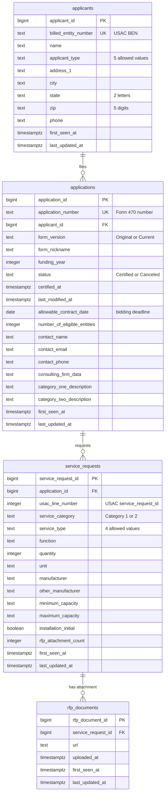

# Database Schema (Milestone 2)

The database holds E-Rate FCC Form 470 filings from USAC Open Data (dataset `jt8s-3q52`) for
Oklahoma and Kansas, funding years 2026 and 2027. The SQL lives in [`db/schema.sql`](../db/schema.sql).

## Entity-relationship diagram

## What one row means

**`applicants`:** One row is one billed entity: a school district, school, library, library system,
or consortium that filed at least one Form 470 in our data. USAC's billed entity number (BEN) is the
natural ID and is unique.

**`applications`:** One row is one Form 470 filing, the public notice that an applicant is seeking bids.
It holds the dates that matter to a vendor (certification and the allowable contract date, which is the
earliest a contract can be signed) and the contact person bidders should reach.

**`service_requests`:** One row is one item or service requested on an application, such as 3 switches
or internet access at one location. Its natural key is the application plus USAC's line number, which
USAC calls `service_request_id` and which only counts 1, 2, 3 within each application.

**`rfp_documents`:** One row is one RFP attachment (a document describing the bid specifications) on one
service request.

## Relationships

- An **applicant** files one or more **applications**. Every application belongs to exactly one applicant.
- An **application** lists zero or more **service requests**. Canceled forms have none.
- A **service request** has zero or more **RFP documents**.

## Design decision: one row per application, preferring the Current version

Form 470 issues two versions of an application. Original, as the author submitted it, or Current,
as it exists after changes have been made to the document. We found it only necessary to include
one version of the application, Current, when it exists, otherwise Original.

This also helps with filtering as in previous versions, filtering by Current
version greatly reduced results because most results were Original.

## A second decision: splitting out RFP documents

The API sends one row per service request per RFP attachment, so one application appeared as 98 rows.
Giving attachments their own table means a service request is stored once, and counting requests or
applications never gets inflated by large numbers of RFP documents.

